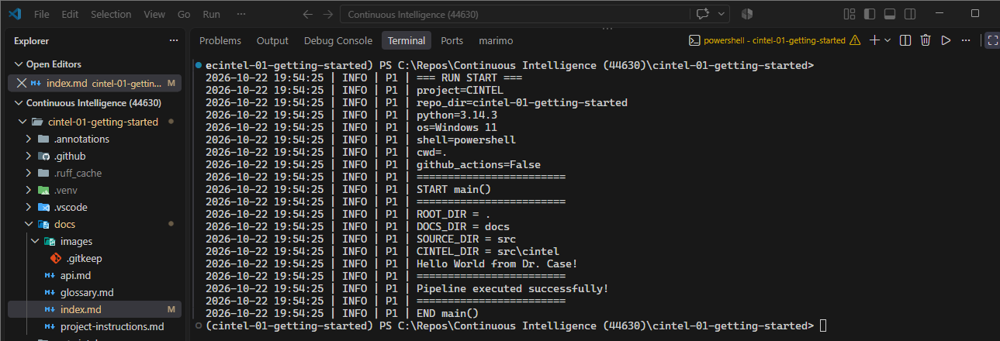

# Continuous Intelligence Project Report

Continuous Intelligence | Project 01 | Angie Crews

## Overview

This project establishes a professional Python environment for developing
and running continuous intelligence applications.

The current project demonstrates that a Python application can be configured,
executed, verified, and maintained using a reproducible workflow. As the
project develops, I plan to explore data quality monitoring by checking data
for issues such as missing information and duplicates.

## Tools and Methods

The project uses:

- Python for application logic.
- uv for Python and dependency management.
- Git and GitHub for version control.
- Logging for execution records.
- Ruff, ty, and pytest for code verification.
- Zensical and GitHub Pages for published documentation.

The pipeline is organized as a Python module with a `main()` function and
structured logging. It also uses project folder paths to organize and identify
important areas of the project.

## Verification

I ran the project from the VS Code terminal using:

`uv run python -m cintel.pipeline`

The pipeline ran successfully and displayed information about the Python
environment and important project folder paths.

The execution ended with:

`Pipeline executed successfully!`

The successful results verify that the project environment is configured
correctly and that the Python pipeline can run as expected.

### Successful Pipeline Execution

The following screenshot shows the successful execution of the Python pipeline:

## Interpretation

Successfully running the pipeline confirms that the development environment
is ready for future analytics work. The project provides a foundation for
adding additional features while keeping the workflow organized and
reproducible.

For a future data quality monitoring project, this foundation could be used
to check data for issues such as missing information or duplicates and log
the results for review.

## Documentation Index

- **Home** - this landing page
- [**Project Instructions**](project-instructions.md)
- [**Glossary**](glossary.md)
- [**API**](api.md)

## Project Links

- [My GitHub Repository](https://github.com/Angie-Crews/cintel-01-getting-started)
- [My Pipeline](https://github.com/Angie-Crews/cintel-01-getting-started/blob/main/src/cintel/pipeline.py)
- [Original Example Project](https://github.com/denisecase/cintel-01-getting-started)

## Project Resources

- [Project Instructions](project-instructions.md)
- [Professional Python Guide](https://denisecase.github.io/pro-analytics-02/)
- [Professional Python Project Explainer](https://pup-pack.github.io/professional-python-project-explainer/).
